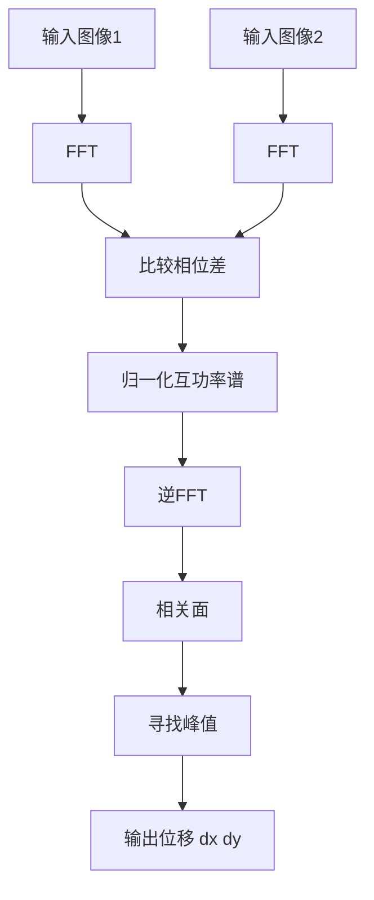

# 解释模板与示例

## 通用算法解释模板

解释单个算法名词时，优先按下面顺序组织：

1. 用普通话说明它解决什么问题
2. 说明朴素方法是什么，以及朴素方法的缺陷
3. 说明算法的核心想法
4. 说明关键数学对象或信号对象
5. 拆解处理步骤
6. 说明输出结果代表什么
7. 说明为什么这个输出有用
8. 说明失败条件
9. 说明工程实现注意点
10. 必要时给最小伪代码或 C++/OpenCV 示例

## PhaseCorrelate 解释骨架

解释 `cv::phaseCorrelate`、相位相关、图像配准或平移估计时，使用本骨架。

### 初学者直觉

有两张图，内容基本一样，但其中一张相对另一张发生了平移。目标是估计这个平移量 `(dx, dy)`。

最直接的方法是在空间域里把一张图到处滑动，每滑一次就和另一张图比较相似度。这个方法直观，但大图上可能比较慢。

相位相关的思路是：把图像转换到频域。在频域里，图像平移主要表现为相位变化。只要把两张图的相位差提取出来，再逆变换回空间域，就能得到一个相关面。相关面峰值所在位置就是位移。

### 概念链条

1. **图像平移**
   - 图像 B 如果是图像 A 平移 `(dx, dy)` 得到的，那么两张图内容相同，但坐标整体偏移。

2. **FFT**
   - FFT 把图像拆成很多频率成分。
   - 低频表示缓慢变化的亮度或大结构。
   - 高频表示边缘、纹理和细节。
   - 每个频率成分包含幅值和相位。

3. **相位**
   - 幅值表示某个频率有多强。
   - 相位表示这个频率模式在图像中的位置关系。
   - 图像发生平移时，频率强度结构大体不变，主要变化体现在相位上。

4. **互功率谱**
   - 两张图 FFT 后得到 `F1` 和 `F2`。
   - 互功率谱常写成：
     `R = (F1 * conj(F2)) / |F1 * conj(F2)|`
   - `conj(F2)` 是复共轭，用来比较两张图的相位差。
   - 除以幅值是归一化，让结果更关注位移对应的相位差，而不是亮度强弱。

5. **逆 FFT**
   - 把归一化后的相位差信息转换回空间域。
   - 得到的是相关面。

6. **相关面**
   - 相关面是一张二维响应图。
   - 每个位置代表“这个位移有多可能”。
   - 峰值位置就是最可能的平移量。

7. **亚像素估计**
   - 如果峰值落在像素之间，可以对峰值附近做质心或拟合，得到小数级位移。

### Mermaid 流程图



### 为什么使用 PhaseCorrelate

适合两张图主要差异是平移，并且需要快速估计全局位移的场景。

典型场景：

- 图像配准
- 模板对齐
- 相机抖动补偿
- 连续帧偏移估计
- 缺陷检测前的 ROI 对齐
- 印刷图案位置修正

### 优点

- 大图上通常比暴力滑窗匹配更高效。
- 可以估计亚像素位移。
- 因为做了幅值归一化，对整体亮度缩放比普通相关更不敏感。

### 失败条件

- 两张图存在明显旋转或尺度变化。
- 存在大形变。
- ROI 中有强重复周期纹理。
- 图像纹理太少或对比度太低。
- 遮挡或缺陷区域占比过大。
- 光照变化是局部且非线性的。
- 边界突变明显但没有加窗处理。

### 工程注意点

- 尽量用稳定 ROI，避免无关背景参与估计。
- 输入建议使用浮点图像。
- 边界效应强时使用 Hanning 窗。
- 检查 `response`，低响应说明位移估计不可靠。
- 工业视觉中不能盲信位移结果，要加位移范围检查和 fallback。
- 高频调用时预分配缓冲区，避免热路径重复分配内存。

### OpenCV 4.5.5 示例

要写清楚注释

```cpp
cv::Mat hann;
cv::createHanningWindow(hann, image1.size(), CV_64F);

cv::Point2d shift = cv::phaseCorrelate(
    image1_64f,
    image2_64f,
    hann,
    &response
);
```

`response` 可以理解成类似置信度的指标，但不是绝对保证。实际工程中还要结合位移范围、相关峰形状、ROI 内容和历史帧稳定性判断。
